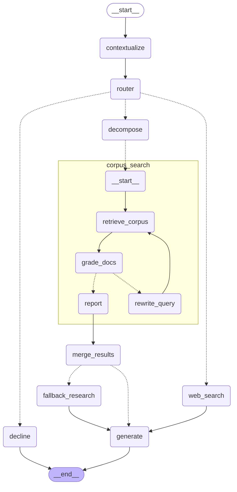

# AI Code Assistant (Self-Reflective) — a self-evaluating agentic RAG assistant over arXiv

> Built on [ai-code-assistant](https://github.com/Francisco-J-Gomez/ai-code-assistant). This version adds self-reflection: the agent evaluates its RAG answers and uses extra tools and techniques to improve them when needed. _(Work in progress.)_

A research assistant for AI and software-development questions, grounded in
~30k arXiv papers (2020–present). Ask a question in a chat UI and a
LangGraph agent routes it, retrieves sources and answers from them, with
sources attached to every answer.

Built as a learning project to get hands-on with LangChain, LangGraph, RAG,
and tool-using agents.

## What the agent does

Every question is first rewritten as a standalone question (follow-ups like
"what benchmark did *they* introduce?" are resolved from the conversation),
then routed down one of four paths:

| Situation | What happens |
|---|---|
| **Research question, answered by the paper corpus** | Retrieves the top matches from Pinecone and answers from them, citing each paper (title + arXiv link). |
| **Research question with too few relevant papers** | The question is split into its parts; for each part, retrieved papers are graded and the best 3 relevant kept; if too few pass, the query is rewritten once; parts still not covered go to a small research sub-agent (web + live arXiv), and the answer says it includes a live search. |
| **Practical tool / library / docs question** | Goes straight to web search — papers don't cover how to configure LangSmith. |
| **Out of scope** (cooking, trivia, …) | Declines politely, with no search and no generation. If nothing relevant turns up anywhere, it says so rather than guessing. |

Each answer in the chat UI has a collapsible "Sources" list, labeled by
whether it came from the corpus or the web.

## Quickstart

Requires [uv](https://docs.astral.sh/uv/) (it will fetch Python 3.12+ if needed).

```bash
uv sync                                  # create .venv, install locked deps
cp .env.example .env                     # then fill in your own keys
uv run streamlit run ui/chat_app.py      # open the chat UI
```

You need `OPENAI_API_KEY`, `PINECONE_API_KEY`, and `TAVILY_API_KEY`. The app
queries an existing Pinecone index, so **populate it first** by running the
ingestion pipeline — see [ingestion/README.md](ingestion/README.md).

Run the tests (fast, mocked, no network):

```bash
uv run pytest -q
```

Opt-in tests against the real OpenAI / Pinecone / Tavily / arXiv APIs live in
[integration_tests/](integration_tests/) and are skipped unless their env flag
is set — see [agent/README.md](agent/README.md#tests).

## How it works



An explicit LangGraph `StateGraph` (diagram generated from the compiled
graph). The routing policy is enforced by **graph edges**, not by a system
prompt the model may or may not follow:

- `contextualize` → standalone question (LLM only on follow-ups);
- `router` → `corpus` / `web` / `out_of_scope` (structured output);
- `decompose` → one `corpus_search` subgraph per sub-query, in parallel:
  `retrieve_corpus` → `grade_docs` (keep the best 3 relevant) → maybe
  `rewrite_query` once → `merge_results` → `generate`, or
  `fallback_research` for uncovered parts — a ReAct sub-agent with web and
  live-arXiv tools and hard call limits;
- `generate` answers only from the relevant sources, with citations.

The only loop is one query rewrite per sub-query: 2–5 LLM calls on the
common paths, ~10 on the full corrective path (OpenAI `gpt-5-mini`). Node-by-node
details in [agent/README.md](agent/README.md); how it got here, phase by
phase, in [docs/phases/](docs/phases/).

Two independent systems, built and tested separately:

- **Online agent** (`agent/`, `ui/`) — question → retrieve → answer with sources.
- **Offline ingestion** (`ingestion/`) — fetch → normalize → chunk → embed →
  upsert into Pinecone. See [ingestion/README.md](ingestion/README.md).

## Key decisions

| Question | Decision |
|---|---|
| Agent LLM | **OpenAI `gpt-5-mini`** — single-provider stack (same account as embeddings); tool-calling confirmed working. |
| Control flow | **Explicit `StateGraph`** — routing and fallback are graph edges; each LLM node has one narrow prompt and structured output. |
| Routing | An **LLM router** (`corpus` / `web` / `out_of_scope`) before retrieval; when unsure it picks the corpus, which can still fall back to the web. |
| Relevance gating | **Corrective RAG**: every retrieved paper is graded; too few relevant → one query rewrite → a bounded research sub-agent (**Tavily** web + live **arXiv API**). |
| Evaluation | A 40-question **LangSmith** eval set (6 categories) with code evaluators and `gpt-5` judges; every phase is compared against the Phase 0 baseline — see [evals/README.md](evals/README.md). |
| Knowledge base | Official **arXiv API** (no scraping), abstracts only for now, embedded with **`text-embedding-3-small`** and stored in **Pinecone**. |

Full design notes: [docs/agent-plan.md](docs/agent-plan.md) and
[docs/data-ingestion-plan.md](docs/data-ingestion-plan.md). Deferred work and
open questions (chunking benchmarks, alternative embedding models, …) are in
[TODO.md](TODO.md).

## Tech stack

- **LangChain / LangGraph** — agent graph, structured outputs, conversation memory.
- **LangSmith** — tracing, eval datasets and experiments.
- **OpenAI** — chat model (`gpt-5-mini`) and embeddings (`text-embedding-3-small`).
- **Pinecone** — vector store.
- **Tavily** — live web search.
- **Streamlit** — chat UI.
- **arXiv API** — paper metadata source, and live search in the research fallback.
- **uv** — environment and dependency management.

## Repo layout

| Path | What's in it |
|---|---|
| `agent/` | The LangGraph agent: state, nodes, graph wiring, prompts, config. |
| `ui/` | Streamlit chat app. |
| `evals/` | LangSmith eval set, evaluators, and the per-phase results. |
| `ingestion/` | Offline pipeline that builds the Pinecone corpus (plus `inspect_db` for browsing its SQLite store). |
| `tests/` | Fast mocked unit tests. |
| `integration_tests/` | Opt-in tests against real external APIs. |
| `docs/` | Design plans (agent, ingestion, self-reflective RAG) and a write-up per phase in `docs/phases/`. |
