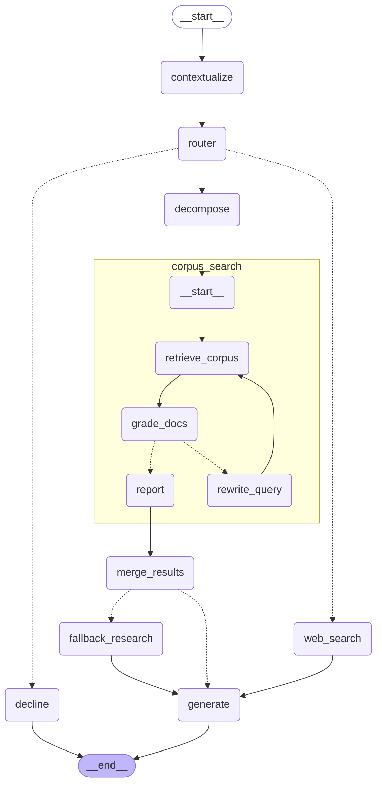

# Agent and chat UI (online)

The serving side of the project: a LangGraph `StateGraph` agent that answers
AI / software-development questions from the arXiv corpus, falling back to web
search, plus the Streamlit chat app on top of it.

**Status: implemented** and verified end-to-end against real
OpenAI / Pinecone / Tavily, including by hand through the chat UI in a browser.
Full design notes: [../docs/agent-plan.md](../docs/agent-plan.md). Deferred
work: [../TODO.md](../TODO.md).

## Running the chat app

Prerequisites: `uv sync`, a `.env` with `OPENAI_API_KEY`, `PINECONE_API_KEY`
and `TAVILY_API_KEY` (copy `.env.example`), and a populated Pinecone index —
see [../ingestion/README.md](../ingestion/README.md).

```bash
uv run streamlit run ui/chat_app.py
```

Opens a browser tab with a chat UI. Ask anything about AI/software-dev
research or tools — research questions are answered from the relevant papers
in the corpus (retrying with a rewritten query, then searching the web and
live arXiv if too few are relevant), practical tool/library questions go
straight to web search, and anything unrelated is declined. Each
answer has a collapsible "Sources" list, deduplicated by URL and labeled by
whether it came from the paper corpus or the web. The **New Chat** button
starts a fresh conversation thread.

## How the agent works

An explicit LangGraph `StateGraph` (`graph.py`). The actual compiled
structure (`graph.get_graph().draw_mermaid()`, not hand-drawn):



Control flow is enforced by the graph's edges, not by a system prompt the
LLM may or may not follow. The only loop is one bounded query rewrite per
sub-query, and the research sub-agent has hard call limits. LLM calls per
turn: 2 on the web route, 4 when the corpus answers on the first search
(+1 per extra sub-query), ~10 on the full corrective path (+1 on follow-ups
for `contextualize`).

1. **`contextualize`** (LLM, follow-ups only): rewrites the latest message
   as a standalone question using the conversation, so "what benchmark did
   *they* introduce?" becomes "what benchmark did RepoCoder introduce?". On
   the first turn there is nothing to resolve, so no LLM call. Also resets
   the per-turn state (the checkpointer keeps state across turns).
2. **`router`** (LLM, structured output `RouteDecision`), on the standalone
   question:
   - `corpus` - research questions (methods, findings, benchmarks, papers);
   - `web` - practical questions about a specific tool, library, product,
     API or release, which papers don't cover;
   - `out_of_scope` - not AI / software development.

   When unsure it picks `corpus`, because that path can still fall back to
   live search and the web path never checks the corpus.
3. **`decline`**: out of scope → fixed message, no retrieval, no generation.
4. **`decompose`** (LLM, `SubQueries`): splits a multi-part question into
   self-contained sub-queries (at most `max_sub_queries`, 3); a single-part
   question stays one query. Each sub-query is sent, in parallel (`Send`),
   to its own run of the `corpus_search` subgraph:
   - **`retrieve_corpus`**: embeds the query and retrieves the top-k (5)
     chunks from Pinecone; chunks already seen in this run are skipped.
   - **`grade_docs`** (LLM, `DocGrades`, model `grader_model`): grades every
     new chunk against the *sub-query* in one call and keeps the
     best-ranked relevant ones, at most `max_relevant_docs` (3) per
     sub-query.
   - **`rewrite_query`** (LLM): if fewer than `min_relevant_docs` (1) are
     relevant, a better query in the vocabulary of paper abstracts, then
     search again - at most `max_query_rewrites` (1) times.
   - **`report`**: hands the sub-query's result back (relevant chunks,
     everything retrieved, enough or not).
5. **`merge_results`**: joins the runs - relevant chunks in sub-query order,
   de-duplicated - and lists the sub-queries the corpus didn't cover. All
   covered → `generate`; otherwise → `fallback_research`.
6. **`fallback_research`** (`research.py`): a small `create_agent` ReAct
   sub-agent with `web_search` (Tavily) and `arxiv_search` (live arXiv API)
   tools, capped by `ModelCallLimitMiddleware` / `ToolCallLimitMiddleware`,
   told which parts are missing. It only searches; the documents its tools
   return are handed to `generate`, with the relevant corpus chunks.
7. **`web_search`** (Tavily): the direct web route.
8. **`generate`** (LLM): answers the user's question (with the conversation)
   only from the documents, citing them. The "grounded in the corpus" /
   "includes a live search" line is chosen by the graph from the documents.

The UI and evals read the outcome from the final state: `route`
(`corpus` / `web` / `decline`) and `documents` (both corpus and web, in one
`Document` shape).

## Files

| File | Purpose |
|---|---|
| `config.py` | `AgentConfig` — models (`llm_model`, `grader_model`), retrieval `top_k`, corrective-RAG knobs (`max_sub_queries`, `min_relevant_docs`, `max_relevant_docs`, `max_query_rewrites`), research sub-agent call limits. Composes `EmbeddingConfig` from `ingestion/` so queries are embedded with the same model/dimension/index as the corpus. |
| `state.py` | `AgentState` (graph state), `CorpusSearchState` / `SubQueryResult` (the per-sub-query subgraph), and `Document` (one shape for corpus chunks, web results and live-arXiv papers). |
| `schemas.py` | Structured LLM outputs: `RouteDecision`, `SubQueries`, `DocGrades`. |
| `prompts.py` | One narrow prompt per LLM node, plus the decline message. |
| `components.py` | `AgentComponents`: every external call the nodes make (LLMs, corpus, web, research sub-agent). Injected into `build_graph()` so control flow is unit-tested with fakes (`tests/test_graph.py`). |
| `nodes.py` | The node functions `(state, components[, settings]) -> state update` and the routing functions for the conditional edges. |
| `graph.py` | Wiring only: `build_graph()` (nodes, edges, `InMemorySaver` checkpointer), `build_corpus_search()` (the per-sub-query subgraph) and `studio_graph()` for `langgraph dev`. |
| `retrieval.py` | `make_corpus_search()` (Pinecone query used by `retrieve_corpus`) and the `search_papers` tool wrapping it for tool-calling agents. |
| `research.py` | The `fallback_research` sub-agent: `create_agent` + call-limit middleware, `web_search` and `arxiv_search` tools returning `Document`s. |
| `results.py` | `sources_from_documents()` (deduplicated citations) and `answer_badge()` (corpus / web / not-grounded badge) from the final state. Used by the UI; unit-tested. |
| `../ui/chat_app.py` | Streamlit chat interface: session state, rendering, styling. |

Conversation memory is process-local (lost when the Streamlit server
restarts), which is fine for local single-user use.

## Tests

```bash
uv run pytest -q    # fast mocked unit tests (includes the retrieval tool)
```

Opt-in tests against the real APIs are in
[../integration_tests/](../integration_tests/) and are skipped by default
because they cost a little money and need credentials:

```bash
RUN_AGENT_INTEGRATION_TESTS=1 uv run pytest integration_tests/test_agent_integration.py -v
RUN_ARXIV_INTEGRATION_TESTS=1 uv run pytest integration_tests/test_arxiv_integration.py -v
RUN_INGESTION_INTEGRATION_TESTS=1 uv run pytest integration_tests/test_ingestion_pipeline.py -v
```

The agent suite covers every path: the corpus route, the direct web route,
the corrective path ending in `fallback_research`, the out-of-scope decline,
and a follow-up resolved from conversation history.
