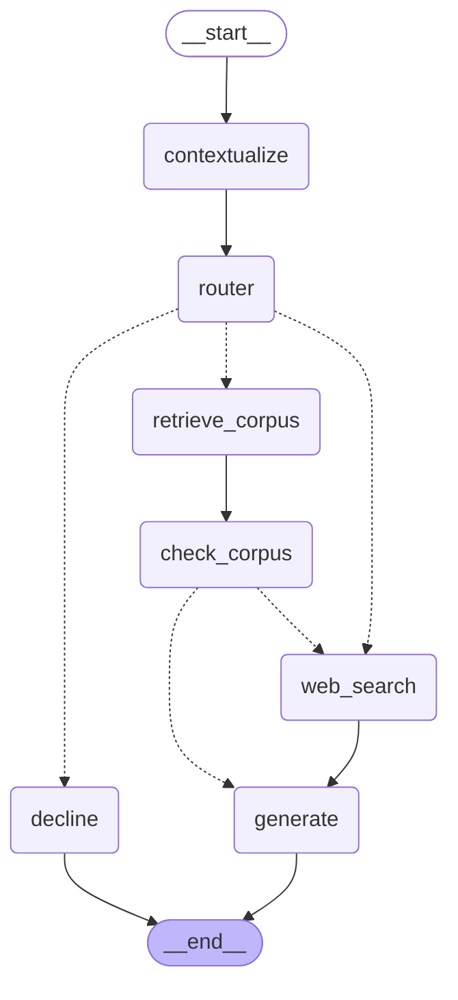

# Agent and chat UI (online)

The serving side of the project: a LangGraph `StateGraph` agent that answers
AI / software-development questions from the arXiv corpus, falling back to web
search, plus the Streamlit chat app on top of it.

**Status: implemented** and verified end-to-end against real
OpenAI / Pinecone / Tavily, including by hand through the chat UI in a browser.
Full design notes: [../docs/agent-plan.md](../docs/agent-plan.md). Deferred
work: [../TODO.md](../TODO.md).

## Running the chat app

Prerequisites: `uv sync`, a `.env` with `OPENAI_API_KEY`, `PINECONE_API_KEY`
and `TAVILY_API_KEY` (copy `.env.example`), and a populated Pinecone index —
see [../ingestion/README.md](../ingestion/README.md).

```bash
uv run streamlit run ui/chat_app.py
```

Opens a browser tab with a chat UI. Ask anything about AI/software-dev
research — the agent searches the corpus first, falls back to a live web
search (still scoped to AI/software-dev topics) if the corpus has nothing
relevant, and declines outright if the question is unrelated to either. Each
answer has a collapsible "Sources" list, deduplicated by URL and labeled by
whether it came from the paper corpus or the web. The **New Chat** button
starts a fresh conversation thread.

## How the agent works

An explicit LangGraph `StateGraph` (`graph.py`). The actual compiled
structure (`graph.get_graph().draw_mermaid()`, not hand-drawn):



Control flow is enforced by the graph's edges, not by a system prompt the
LLM may or may not follow. There is no loop: a turn makes at most 4 LLM
calls (contextualize on follow-ups, router, corpus check, generation).

1. **`contextualize`** (LLM, follow-ups only): rewrites the latest message
   as a standalone question using the conversation, so "what benchmark did
   *they* introduce?" becomes "what benchmark did RepoCoder introduce?". On
   the first turn there is nothing to resolve, so no LLM call. Also resets
   the per-turn state (the checkpointer keeps state across turns).
2. **`router`** (LLM, structured output `RouteDecision`), on the standalone
   question:
   - `corpus` - research questions (methods, findings, benchmarks, papers);
   - `web` - practical questions about a specific tool, library, product,
     API or release, which papers don't cover;
   - `out_of_scope` - not AI / software development.

   When unsure it picks `corpus`, because that path can still fall back to
   the web and the web path never checks the corpus.
3. **`decline`**: out of scope → fixed message, no retrieval, no generation.
4. **`retrieve_corpus`**: embeds the standalone question and retrieves the
   top-k chunks from Pinecone.
5. **`check_corpus`** (LLM, `CorpusCheck`): does the retrieved text actually
   answer the question? Yes → `generate`; no → `web_search`.
6. **`web_search`** (Tavily): on the web route, the only documents; on the
   corpus fallback, added to the corpus documents.
7. **`generate`** (LLM): answers the user's question (with the conversation)
   only from the documents, citing them, and says plainly when they don't
   answer it.

The UI and evals read the outcome from the final state: `route`
(`corpus` / `web` / `decline`) and `documents` (both corpus and web, in one
`Document` shape).

## Files

| File | Purpose |
|---|---|
| `config.py` | `AgentConfig` — LLM model/temperature, retrieval `top_k`, web-search result count. Composes `EmbeddingConfig` from `ingestion/` so queries are embedded with the same model/dimension/index as the corpus. |
| `state.py` | `AgentState` (graph state) and `Document` (one shape for corpus and web results). |
| `schemas.py` | Structured LLM outputs: `RouteDecision`, `CorpusCheck`. |
| `prompts.py` | One narrow prompt per LLM node, plus the decline message. |
| `components.py` | `AgentComponents`: the LLM / corpus / web functions the nodes call. Injected into `build_graph()` so control flow is unit-tested with fakes (`tests/test_graph.py`). |
| `nodes.py` | The node functions `(state, components) -> state update` and the routing functions for the conditional edges. |
| `graph.py` | Wiring only: `build_graph()` (nodes, edges, `InMemorySaver` checkpointer) and `studio_graph()` for `langgraph dev`. |
| `retrieval.py` | `make_corpus_search()` (Pinecone query used by `retrieve_corpus`) and the `search_papers` tool wrapping it for tool-calling agents. |
| `results.py` | `sources_from_documents()` (deduplicated citations) and `answer_badge()` (corpus / web / not-grounded badge) from the final state. Used by the UI; unit-tested. |
| `../ui/chat_app.py` | Streamlit chat interface: session state, rendering, styling. |

Conversation memory is process-local (lost when the Streamlit server
restarts), which is fine for local single-user use.

## Tests

```bash
uv run pytest -q    # fast mocked unit tests (includes the retrieval tool)
```

Opt-in tests against the real APIs are in
[../integration_tests/](../integration_tests/) and are skipped by default
because they cost a little money and need credentials:

```bash
RUN_AGENT_INTEGRATION_TESTS=1 uv run pytest integration_tests/test_agent_integration.py -v
RUN_ARXIV_INTEGRATION_TESTS=1 uv run pytest integration_tests/test_arxiv_integration.py -v
RUN_INGESTION_INTEGRATION_TESTS=1 uv run pytest integration_tests/test_ingestion_pipeline.py -v
```

The agent suite covers every path: the corpus route, the direct web route,
the corpus → web fallback, the out-of-scope decline, and a follow-up
resolved from conversation history.
